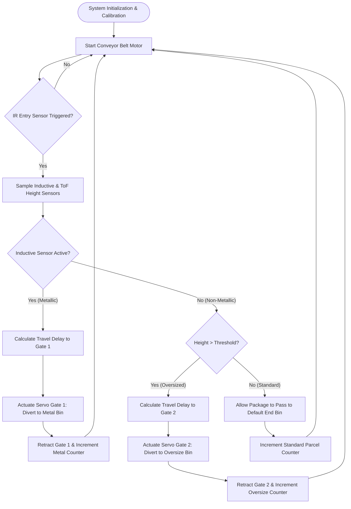

# Task 3: Automated Sensor-Based Conveyor Sorting System Design

**Program:** CodeAlpha Robotics & Automation Internship  
**Task:** Task 3 – Automation System Design  
**System:** Intelligent Industrial Conveyor Sorting System (Material & Height Classification)  
**Author:** Robotics & Automation Intern  
**Date:** September 2026  

---

## 1. System Overview & Objective
In modern manufacturing and distribution facilities (Industry 4.0), automated material handling systems are critical for high-throughput package sorting, quality inspection, and dispatch routing. This project presents the end-to-end design of an **Intelligent Automated Conveyor Sorting System**. The system autonomously detects incoming objects on a continuously driven belt, classifies them based on material composition (metallic vs. non-metallic) and dimensional profile (height threshold), and dynamically diverts them into designated classification bins using electro-pneumatic/servo pusher gates.

---

## 2. Hardware Architecture & Component Specification

```
                                SYSTEM SCHEMATIC
+-------------------------------------------------------------------------------+
|                                                                               |
|   [Object Infeed]                                                             |
|          |                                                                    |
|          v                                                                    |
|  ==============[ CONVEYOR BELT (DC Geared Motor + L298N Driver) ]============ |
|          |                  |                        |                |       |
|    [Sensor 1: IR]     [Sensor 2: Inductive]    [Sensor 3: ToF]        |       |
|    Presence Detection Metal Classification     Height Measurement     |       |
|          |                  |                        |                |       |
|          +------------------+------------------------+                |       |
|                             |                                         |       |
|                             v                                         |       |
|                +--------------------------+                           |       |
|                |  MICROCONTROLLER / PLC   |                           |       |
|                |   (ATmega328P / ESP32)   |                           |       |
|                +--------------------------+                           |       |
|                             |                                         |       |
|              +--------------+---------------+                         |       |
|              |                              |                         |       |
|              v                              v                         v       |
|       [Servo Diverter 1]            [Servo Diverter 2]        [Main Bin Exit] |
|       (Metallic Objects)            (Tall Non-Metallic)       (Standard Box)  |
+-------------------------------------------------------------------------------+
```

### 2.1 Sensor Suite:
1. **Infrared (IR) Optical Beam Sensor (E18-D80NK):**
   * *Function:* Detects the leading edge of an item entering the inspection zone.
   * *Interface:* Digital GPIO pin with interrupt trigger.
2. **Inductive Proximity Sensor (LJ12A3-4-Z/BX):**
   * *Function:* Generates an electromagnetic eddy-current field to detect ferrous/conductive metallic targets up to 4 mm.
   * *Output:* NPN open-collector stepped down to 5V logic via optocoupler isolation.
3. **Ultrasonic / Laser ToF Range Sensor (VL53L0X):**
   * *Function:* Measures vertical clearance to compute package height ($h_{\text{object}} = h_{\text{belt}} - h_{\text{sensor}}$).
   * *Interface:* $I^2C$ bus communication.

### 2.2 Actuator & Drive Mechanism:
1. **Conveyor Drive Motor:** 12V High-Torque Planetary DC Gearmotor regulated via an L298N Dual H-Bridge motor driver with PWM speed regulation.
2. **Sorting Gates / Diverters:** Dual high-torque metal-gear servomotors (MG996R) operating high-speed diverter arms ($0^\circ \to 60^\circ$ sweep) to guide parcels into Bin A or Bin B.
3. **Audio-Visual Annunciator:** RGB status LED indicator tower and piezo buzzer for jam detection or emergency stop (E-Stop) conditions.

---

## 3. System Logic & Control Flowchart



---

## 4. Circuit Interconnection & Pin Mapping

| Component | Signal Name | Controller Pin | Electrical Characteristics |
| :--- | :--- | :--- | :--- |
| **IR Entry Sensor** | `IR_TRIG` | Digital Pin 2 (INT0) | 5V Active-LOW |
| **Inductive Sensor** | `PROX_IN` | Digital Pin 3 (INT1) | 5V via Optocoupler / Resistor Divider |
| **ToF Rangefinder** | `SDA / SCL` | A4 / A5 ($I^2C$) | 3.3V / 5V $I^2C$ pull-up |
| **Motor PWM** | `MTR_EN` | Digital Pin 9 (PWM) | 0–255 Duty Cycle (12V Supply) |
| **Motor Dir A / B** | `IN1 / IN2` | Digital Pin 7, 8 | 5V Logic Direction |
| **Diverter Servo 1** | `SERVO_1` | Digital Pin 5 (PWM) | 5V 50 Hz PWM Pulse ($1.0\text{--}2.0\text{ ms}$) |
| **Diverter Servo 2** | `SERVO_2` | Digital Pin 6 (PWM) | 5V 50 Hz PWM Pulse ($1.0\text{--}2.0\text{ ms}$) |
| **E-Stop Button** | `ESTOP` | Digital Pin 4 | Normally Closed (NC) Pull-up |

---

## 5. Industrial Safety & Failsafe Measures
1. **Emergency Stop (E-Stop) Interlock:** A hardware-level emergency stop immediately cuts motor power via a relay coil while flagging a high-priority software interrupt.
2. **Jam Detection Algorithm:** If an object triggers the entry IR sensor but fails to reach the divert station within a designated watchdog window ($\Delta t > t_{\text{max}}$), the conveyor halts, flashes an error indicator, and sounds an audible alarm.
3. **Optical Isolation:** Industrial proximity sensors operate on 12V/24V rails and are decoupled from 5V microcontroller logic via PC817 optocouplers to prevent inductive spike damage.

---

## 6. Conclusion
The proposed Automated Conveyor Sorting System demonstrates a robust, cost-effective automation solution aligned with contemporary industrial standards. By integrating multi-modal sensing (optical, inductive, and time-of-flight) with real-time feedback control, the system achieves autonomous, deterministic classification with zero manual sorting latency.
